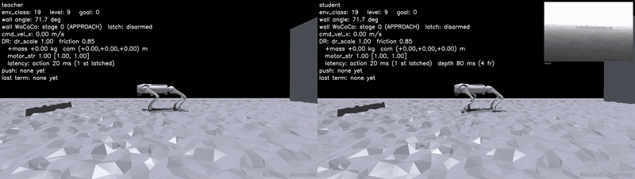
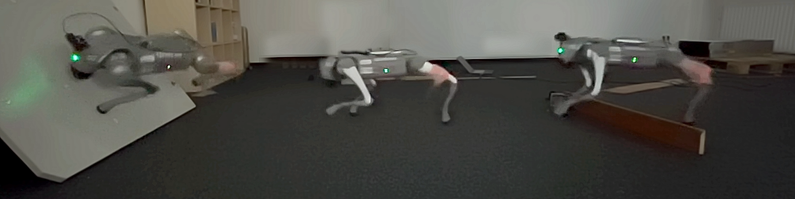
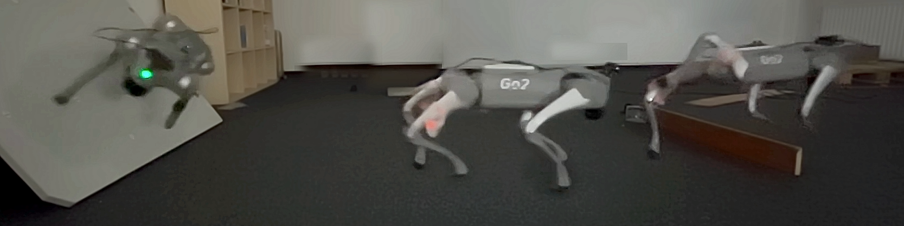

# Learning Agile Flyball Swimmer's Turns for Quadruped Robots via Zero-Shot Reinforcement Learning

<p align="center">

<br/>
<em>Privileged teacher (left) and depth-camera student
(right).</em>
</p>

Fork of [**Extreme Parkour with Legged Robots**](https://extreme-parkour.github.io)
(Cheng, Shi, Agarwal, Pathak — [arXiv:2309.14341](https://arxiv.org/abs/2309.14341)),
retargeted from the A1 to the **Unitree Go2**.

The task is the **flyball wall**: the robot runs toward an angled wall, plants its feet on the
face at prescribed per-foot targets ("foothold goals"), and pushes off to reverse direction. 

Beyond upstream:

- **Flyball-wall terrain** (`utils/flyball_wall.py`, `utils/terrain.py`) with per-foot
  foothold goals (`resources/footholds/*.npz`), curriculum and landing shaping
  (`utils/curriculum_ramp.py`, `utils/parabolic_clearance.py`).
- **Warp depth rendering** (`utils/warp_cam.py`) with a D435-style stereo-shadow model and
  configurable hole filling (`utils/depth_hole_fill.py`).
- **Go2 model** with optional Jetson Orin payload.
- **Dual-encoder PPO** (`go2_teacher`, `go2_flat`): height-scan and depth-image latents
  are concatenated in the actor, with latent consistency and gated height-weight decay.
- **Single-stage depth policy** (`go2_depth`): one PPO run on the deployable observation
  set, the depth latent standing in for the height-scan latent — no distillation stage.
  See [`go2_depth`](#go2_depth--one-policy-student-observations-teacher-rewards).


Deployment — MuJoCo sim2sim, ROS 2 stack, lives in [**go2-sim2sim2real**](https://github.com/Roman-089/go2-sim2sim2real).

## Hardware

<p align="center">

<br/>

<br/>
<em>Go2 hardware: wall, flat ground and plank.</em>
</p>

## License

> [!IMPORTANT]
> This codebase is under **CC BY-NC 4.0** license, with inherited license in Legged Gym
> and RSL RL from ETH Zurich, Nikita Rudin and NVIDIA CORPORATION & AFFILIATES. You may
> not use the material for commercial purposes, e.g., to make demos to advertise your
> commercial products.

See [`LICENSE`](LICENSE) (© 2023 Xuxin Cheng, Kexin Shi, Deepak Pathak),
`legged_gym/LICENSE` and `rsl_rl/LICENSE`. The Go2 URDF and meshes in
`legged_gym/resources/robots/go2/` come from Unitree's robot description package.

## Quick Start

### 1. Install

```bash
conda create -n parkour python=3.8
conda activate parkour
pip3 install torch==1.10.0+cu113 torchvision==0.11.1+cu113 torchaudio==0.10.0+cu113 \
    -f https://download.pytorch.org/whl/cu113/torch_stable.html

# Isaac Gym: https://developer.nvidia.com/isaac-gym  (trained on Preview3, Preview4 works)
cd isaacgym/python && pip install -e .

# this fork; the original Go2 port is Roman-089/go2-flyball-parkour
git clone git@github.com:yunhanzheng/go2-flyball-parkour.git
cd go2-flyball-parkour/rsl_rl && pip install -e .
cd ../legged_gym             && pip install -e .
pip install -r requirements.txt
```

Both packages must be installed editable — assets resolve through `LEGGED_GYM_ROOT_DIR`.

> [!NOTE]
> On `ImportError: libpython3.8.so.1.0`: `export LD_LIBRARY_PATH=$CONDA_PREFIX/lib:$LD_LIBRARY_PATH`

> [!NOTE]
> Also verified on Isaac Gym **Preview 4** (`1.0rc4`) with Python 3.8, `torch 2.0.1+cu118`,
> `numpy 1.23.5` and `warp-lang 1.10.1`; `requirements.txt` still pins `numpy<1.24`.

### 2. Play a released policy

From `legged_gym/legged_gym/scripts`:

```bash
# privileged teacher (scandots)
python play.py --exptid teacher --checkpoint 3200 --device cuda:0

# depth-camera student
python play.py --exptid student --task go2_student --checkpoint 10000 \
    --use_camera --delay --device cuda:0

# flat-terrain base policy
python play.py --exptid flat_baseline --checkpoint 2400 \
    --terrain_only parkour_flat --device cuda:0

# single-stage depth policy (student observations, teacher rewards)
python play.py --exptid my-depth --proj_name go2-depth --task go2_depth \
    --use_camera --delay --device cuda:0
```

Play runs without domain randomization by default; pass `--full-dr` to replay with the
training DR. Video and `--web` replays are pinned to terrain level 8 unless `--level N` or
`--max_level` is given. The released teacher/flat checkpoints use the legacy 114-D actor
and require their matching legacy policy configuration; current dual-encoder runs require
`--use_camera` and a 146-D checkpoint.

Replay flags: `--video`, `--web`, `--level N`, `--full-dr`, `--all_rough` (every tile on the
rough curriculum), `--overlays` (foothold goals and hurdle-clearance volumes),
`--vel_profile 'vel:secs,...'`.

### 3. Train

| task | config | |
|---|---|---|
| `go2_teacher` | `Go2TeacherCfg` | dual encoder: height scan + depth image + full-state critic |
| `go2_flat` | `Go2FlatCfg` | flat-ground PPO with the same dual-encoder actor |
| `go2_student` | `Go2StudentCfg` | depth camera, distilled from a teacher |
| `go2_depth` | `Go2DepthCfg` | depth camera, **one stage**: student observations + teacher rewards |

```bash
# true dual-encoder flat policy, from scratch (requires a camera)
python train.py --task go2_flat --exptid go2-flat-512-v4-dual \
    --use_camera --max_iterations 5000 --headless --no_wandb --device cuda:0

# dual-encoder teacher
python train.py --task go2_teacher --exptid my-teacher --device cuda:0 \
    --use_camera --headless

# student, distilled from a legacy 114-D teacher
python train.py --task go2_student --exptid my-student --device cuda:0 \
    --resume --resumeid teacher --use_camera --delay

# single-stage depth policy, from scratch
python train.py --task go2_depth --exptid my-depth --proj_name go2-depth \
    --use_camera --delay --headless --device cuda:0

# ... or warm started from a legacy 114-D privileged teacher
python train.py --task go2_depth --exptid my-depth --proj_name go2-depth \
    --resume --resumeid teacher --use_camera --delay --headless --device cuda:0
```

Checkpoints go to `legged_gym/logs/<proj_name>/<exptid>/` (`--proj_name` defaults to
`extreme-parkour`) with the resolved `env_cfg.pkl`, which `play.py` prefers over the live
`.py` config.

Runs log to Weights & Biases (`wandb login` once; `--no_wandb` or `--debug` disables it) —
`--proj_name` doubles as the W&B project, `--exptid` as the run name. Because
`wandb.init(dir="../../logs")` is relative, `train.py` must be started from
`legged_gym/legged_gym/scripts`.

#### Dual-encoder PPO — height scan and depth image

`go2_teacher` and `go2_flat` use two perception encoders in the **main PPO actor**. The
height encoder and depth encoder each produce a 32-D latent; the actor consumes
`concat(height_weight * latent_h, latent_d)`. Its input is therefore **146-D**: 53 proprio
+ 32 height latent + 32 depth latent + 9 explicit privileged state + 20 history latent.
The critic retains its privileged observation.

The depth encoder is a second parameter group in the optimizer that actually performs
the PPO step. Training also minimizes `MSE(latent_h, latent_d)`; `height_weight` decays by
`height_decay_rate` only when the success-rate EMA, mean curriculum level and consistency
EMA all pass their configured gates. The weight is stored in each checkpoint. On flat
ground it normally remains `1.0`, because the curriculum-level gate is not met.

This path is distinct from DAgger and `go2_depth`: those still use one depth latent through
`scandots_latent`, replacing the height latent rather than concatenating with it. Dual PPO
uses `actor_critic.actor` and raw teacher observations for the actor; heading blanking is
applied only to the depth encoder's proprioceptive input. `play.py` and `evaluate.py`
mirror that wiring.

The current flat run is `go2-flat-512-v4-dual`, launched by
`legged_gym/logs/launch_flat.sh`. Its logs and checkpoints are under
`legged_gym/logs/extreme-parkour/go2-flat-512-v4-dual/`.

> [!IMPORTANT]
> Dual-encoder PPO requires `--use_camera`. Older teacher/flat checkpoints with a 114-D
> actor cannot be loaded into the 146-D actor; start a new run without `--resume`.
> `save_jit.py` currently targets the DAgger student export path and is not yet a dual-
> encoder export implementation.

#### `go2_depth` — one policy, student observations, teacher rewards

The release trains two networks in sequence: a privileged `go2_teacher`, then a
`go2_student` that imitates it through the camera. `go2_depth` collapses that chain into a
**single PPO run** — the actor never sees a height scan, and there is no distillation loss.

| | |
|---|---|
| actor | the deployable observation set: proprio 53 + estimator-backed explicit state 9 + **depth-encoder latent 32** + history latent 20 |
| critic | unchanged privileged observation (asymmetric actor–critic) |
| reward | the teacher's shaping, verbatim |
| encoder | a second parameter group inside the PPO optimizer (`depth_encoder.learning_rate`) |

The 32-D depth latent is fed through `scandots_latent`, i.e. it **replaces** the output of
the actor's own scan encoder. That keeps the actor network byte-identical to a **legacy
114-D teacher**, so `--resume --resumeid teacher` is a real warm start rather than a shape
match. A new 146-D dual-encoder teacher is not shape-compatible with this path.

Three details make it hold together:

- **10 Hz camera, 50 Hz control.** `extras["depth"]` is only non-empty every
  `depth.update_interval` (5) control steps, which is what `play.py` mirrors by re-using the
  previous latent in between. Every transition therefore caches the `(frame, hidden-before)`
  pair it was actually conditioned on, and `PPO.update` replays the encoder from that pair —
  the latent stays on-policy, with the GRU truncation at one step.
- **Auxiliary anchor.** `MSE(depth_latent, stopgrad(scan_encoder(obs_scan)))`, scaled by
  `depth_encoder.aux_scan_coef` (default 1.0). Without it the latent's coordinate frame is
  free, and a teacher warm start hands the actor a latent it has never seen.
- **Deploy-time observation.** `PPO.depth_actor_obs()` swaps the privileged state for the
  estimator output and blanks `obs[:, 6:8]` — the two heading command slots that only the
  camera can supply on hardware. The actor is never optimised on an observation it cannot
  see at deployment.

No `depth_actor` is cloned on this path, so `play.py` / `evaluate.py` fall back to
`act_inference(obs, hist_encoding=True, scandots_latent=depth_latent)` and the checkpoint
carries `actor_state_dict` + `depth_encoder_state_dict` only.

Cold start: every env spawns on terrain row 0 (rows 0–3 are hurdle-free but keep the wall
and the pit) with all camera degradations off. Re-enable `class depth` — `latency_range`,
`dis_noise`, `noise_dropout`, `pw_noise`, `self_geometry` — once the policy starts clearing
the wall, then let promotion carry it up to the hurdles. `terminate_on_yaw_tracking` stays
`False`: depth cannot disambiguate the two symmetric wall approaches, while the
lateral-deviation termination still enforces the corridor from depth alone.

> [!IMPORTANT]
> `--use_camera` is what flips `depth_encoder.if_depth` on, and `--delay` latches the action
> delay from step 0 — both are mandatory. Do not set `EP_USE_YAW=1`: the encoder head then
> emits 34 dims and can no longer stand in for the 32-D scan latent (the runner raises).
> The encoder is replayed for every sample inside `update()`, so the cost is roughly
> `num_learning_epochs x num_mini_batches` CNN passes per iteration (16 by default) — drop
> either to 2 if throughput matters more than latent accuracy.

`legged_gym/legged_gym/tests/test_depth_ppo_plumbing.py` guards this wiring on CPU, without
Isaac Gym: cached frames must not be inference tensors, gradients must reach the encoder,
the aux loss must stay finite, and the teacher / DAgger paths must be untouched. Dual-encoder
tests also cover the 146-D actor, mandatory depth latent, encoder updates, history adaptation
and inference-actor selection.

```bash
python -m pytest legged_gym/legged_gym/tests/test_depth_ppo_plumbing.py -s
```

### 4. Export

```bash
python save_jit.py --exptid student     # TorchScript policy
python evaluate.py --exptid student     # success / edge-violation statistics
```

### 5. Deploy

Sim2sim validation and hardware deployment via
[**go2-sim2sim2real**](https://github.com/Roman-089/go2-sim2sim2real)

## Released checkpoints

| path | contents | |
|---|---|---|
| `legged_gym/logs/extreme-parkour/teacher/` | `model_3200.pt` | teacher policy |
| `legged_gym/logs/extreme-parkour/student/` | `model_10000.pt` | student, distilled from the teacher |
| `legged_gym/logs/extreme-parkour/flat_baseline/` | `model_2400.pt` | flat-terrain base, for warm starts |


