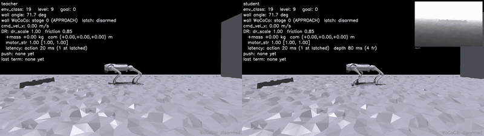
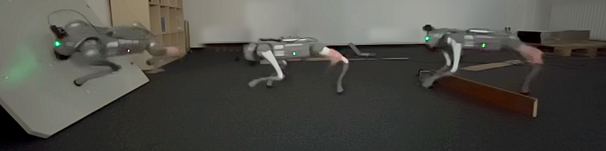
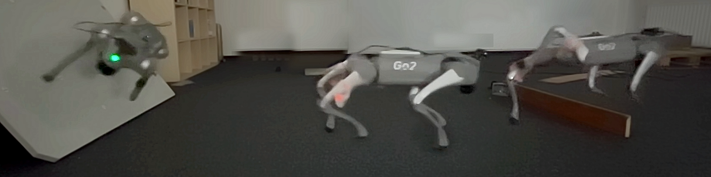

# Learning Agile Flyball Swimmer's Turns for Quadruped Robots via Zero-Shot Reinforcement Learning

<p align="center">

<br/>
<em>Privileged teacher (left) and depth-camera student
(right).</em>
</p>

Fork of [**Extreme Parkour with Legged Robots**](https://extreme-parkour.github.io)
(Cheng, Shi, Agarwal, Pathak — [arXiv:2309.14341](https://arxiv.org/abs/2309.14341)),
retargeted from the A1 to the **Unitree Go2**.

The task is the **flyball wall**: the robot runs toward an angled wall, plants its feet on the
face at prescribed per-foot targets ("foothold goals"), and pushes off to reverse direction. 

Beyond upstream:

- **Flyball-wall terrain** (`utils/flyball_wall.py`, `utils/terrain.py`) with per-foot
  foothold goals (`resources/footholds/*.npz`), curriculum and landing shaping
  (`utils/curriculum_ramp.py`, `utils/parabolic_clearance.py`).
- **Warp depth rendering** (`utils/warp_cam.py`) with a D435-style stereo-shadow model and
  configurable hole filling (`utils/depth_hole_fill.py`).
- **Go2 model** with optional Jetson Orin payload


Deployment — MuJoCo sim2sim, ROS 2 stack, lives in [**go2-sim2sim2real**](https://github.com/Roman-089/go2-sim2sim2real).

## Hardware

<p align="center">

<br/>

<br/>
<em>Go2 hardware: wall, flat ground and plank.</em>
</p>

## License

> [!IMPORTANT]
> This codebase is under **CC BY-NC 4.0** license, with inherited license in Legged Gym
> and RSL RL from ETH Zurich, Nikita Rudin and NVIDIA CORPORATION & AFFILIATES. You may
> not use the material for commercial purposes, e.g., to make demos to advertise your
> commercial products.

See [`LICENSE`](LICENSE) (© 2023 Xuxin Cheng, Kexin Shi, Deepak Pathak),
`legged_gym/LICENSE` and `rsl_rl/LICENSE`. The Go2 URDF and meshes in
`legged_gym/resources/robots/go2/` come from Unitree's robot description package.

## Quick Start

### 1. Install

```bash
conda create -n parkour python=3.8
conda activate parkour
pip3 install torch==1.10.0+cu113 torchvision==0.11.1+cu113 torchaudio==0.10.0+cu113 \
    -f https://download.pytorch.org/whl/cu113/torch_stable.html

# Isaac Gym: https://developer.nvidia.com/isaac-gym  (trained on Preview3, Preview4 works)
cd isaacgym/python && pip install -e .

git clone git@github.com:Roman-089/go2-flyball-parkour.git
cd go2-flyball-parkour/rsl_rl && pip install -e .
cd ../legged_gym             && pip install -e .
pip install -r requirements.txt
```

Both packages must be installed editable — assets resolve through `LEGGED_GYM_ROOT_DIR`.

> [!NOTE]
> On `ImportError: libpython3.8.so.1.0`: `export LD_LIBRARY_PATH=$CONDA_PREFIX/lib:$LD_LIBRARY_PATH`

### 2. Play a released policy

From `legged_gym/legged_gym/scripts`:

```bash
# privileged teacher (scandots)
python play.py --exptid teacher --checkpoint 3200 --device cuda:0

# depth-camera student
python play.py --exptid student --task go2_student --checkpoint 10000 \
    --use_camera --delay --device cuda:0
```

Replay flags: `--video`, `--web`, `--level N`, `--no-dr`, `--all_rough` (every tile on the
rough curriculum), `--overlays` (foothold goals and hurdle-clearance volumes),
`--vel_profile 'vel:secs,...'`.

### 3. Train

| task | config | |
|---|---|---|
| `go2_teacher` | `Go2TeacherCfg` | privileged: scandots + full state |
| `go2_student` | `Go2StudentCfg` | depth camera, distilled from a teacher |

```bash
# teacher
python train.py --task go2_teacher --exptid my-teacher --device cuda:0 --headless

# student, distilled from a trained teacher
python train.py --task go2_student --exptid my-student --device cuda:0 \
    --resume --resumeid my-teacher --use_camera --delay

# warm start from the released flat-terrain base policy
python train.py --task go2_teacher --exptid new-run \
    --resume --resumeid flat_baseline --device cuda:0 --headless
```

Checkpoints go to `legged_gym/logs/<proj_name>/<exptid>/` (`--proj_name` defaults to
`extreme-parkour`) with the resolved `env_cfg.pkl`, which `play.py` prefers over the live
`.py` config.

### 4. Export

```bash
python save_jit.py --exptid student     # TorchScript policy
python evaluate.py --exptid student     # success / edge-violation statistics
```

### 5. Deploy

Sim2sim validation and hardware deployment via
[**go2-sim2sim2real**](https://github.com/Roman-089/go2-sim2sim2real)

## Released checkpoints

| path | contents | |
|---|---|---|
| `legged_gym/logs/extreme-parkour/teacher/` | `model_3200.pt` | teacher policy |
| `legged_gym/logs/extreme-parkour/student/` | `model_10000.pt` | student, distilled from the teacher |
| `legged_gym/logs/extreme-parkour/flat_baseline/` | `model_2400.pt` | flat-terrain base, for warm starts |


